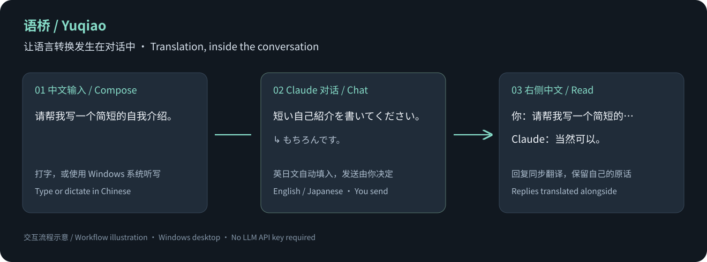

# 语桥 · Yuqiao

### 中文输入，英日文直达 Claude。回复一来，右侧读中文。

为 Claude Windows 客户端准备的双向翻译伴侣。 
**自动填入对话框 · 回复同步翻译 · 无需来回复制粘贴**

**简体中文** · [English](README.en.md)

[下载 Windows 版](https://github.com/zanevictor73-ai/yuqiao-translate/releases/latest) · [三步上手](#三步上手) · [适配范围](#适配范围)

你在语桥中打中文或说中文，**所选的英文或日文自动出现在 Claude 的输入框里**。你自行发送后，Claude 的英文或日文回答会**同步翻译到右侧中文阅读窗**，连同你自己的中文原话一起保留。

**从“我想说什么”到“它回答了什么”，把输入与阅读接成一段连续的对话。** 不必在翻译网站和聊天窗口之间反复搬运文字，也不必为了读新回复不断复制粘贴。

无需配置大模型、购买大模型额度或填写 API Key。翻译使用 Microsoft / Google 普通在线机器翻译服务，**需要联网，并非离线翻译**。

## Claude 适配版：把整段对话连起来

**针对 Claude Windows 桌面的输入、回复阅读、目录和设置，提供完整对话流程适配。** 已验证的流程包括：

- **说中文，英日文任选。** 在「发送语言」切换英文或日文；中文输入停顿后自动翻译，所选译文就绪后直接填入 Claude，并使用对应语言的标点。
- **发送由你决定。** 自动翻译和填入不会发送。你主动按 Enter 才请求发送；中文输入法选字不会误发，Shift + Enter 可换行。
- **下一句话，重新开始。** 确认 Claude 出现本轮用户消息后，清空本地草稿，避免下轮录音接在上一句后面。
- **光标回到对话。** 自动填入后默认回到 Claude，回车和退格作用于 Claude。需要改中文时，点回中文输入框；听写期间保留本地焦点。
- **读到哪里，留在哪里。** 保留自己的中文原话，随后接上回答译文；新回答不会强制把阅读位置拖到最后。
- **界面也能看懂。** 在旁边显示 Claude 目录、头像菜单和设置的中文提示；按可见界面元素排列，不修改 Claude 本身。

这里的“完整流程”指上述明确列出的功能。Claude 更新、页面布局、窗口尺寸和无障碍信息变化仍可能影响适配，**不代表覆盖所有版本和所有界面**。

## 两个版本，按需选择

| | **Claude 适配版 · 主要推荐** | 通用即时翻译版 |
|---|---|---|
| 核心体验 | 中文输入 → 英文或日文自动填入 Claude；回复 → 右侧自动译为中文 | 在独立窗口翻译文字 |
| 语音 | Windows 听写 → 翻译 → 自动填入 | Windows 听写 → 翻译 |
| 阅读与界面 | 自己的中文原话 + 回答译文；输入、阅读、目录悬浮窗独立开关 | 深色窗口、置顶、复制译文 |
| 翻译方向 | 中文 → 英文 / 日文自动填入；英文 / 日文回复 → 中文 | 中文 → 日文 + 英文；日文 / 英文 → 中文 |
| 下载文件 | **Yuqiao-Claude-v1.10.0-windows.zip** | **Yuqiao-General-v1.10.0-windows.zip** |

通用版用于没有适配的场景，不会读取或控制其他软件。两个开源版均为手动打开的便携程序，不包含自动启动、后台启动监听、总控台或系统时区修改。

## 三步上手

1. 从 [Releases 下载页](https://github.com/zanevictor73-ai/yuqiao-translate/releases/latest) 选择一个版本，**解压整个压缩包**。
2. 双击 **Yuqiao.General.exe** 或 **Yuqiao.Claude.exe**。无需安装 Python、Node.js 或大模型软件。
3. 通用版选择翻译方向并输入；Claude 版先打开 Claude Windows 客户端，选择「Claude 客户端」，开启自动翻译 / 自动填入，在「发送语言」选择英文或日文，需要时进入悬浮模式。

语音输入先选择 Windows 中文输入法，再点「语音输入」。识别由 **Windows + H 系统听写**负责，可在系统面板结束录音。系统的语言、麦克风与在线语音设置会影响可用性。

初次使用 Claude 版，先检查自动填入的译文再自行发送。翻译有误可修改中文、检查候选，或直接编辑 Claude 中的英文或日文；程序会避免覆盖不属于自己的草稿。

## 适配范围

| 环境 | 当前状态 |
|---|---|
| Windows 11 x64 | 本地构建、自动检查及桌面功能验证环境 |
| Windows 10，.NET Framework 4.8 | 目标运行环境；尚未单独完成实机验证 |
| Claude Windows 客户端 | 当前重点适配，具有上述完整对话流程 |
| Claude 网页 | 暂未正式支持自动跟随与填入；可用通用版独立翻译 |
| macOS / Linux / Windows ARM | 未验证，不提供兼容承诺或对应安装包 |

本次发布仅以 Claude Windows 客户端作为对话集成的正式介绍对象，不将未完成流程验证的其他 AI 宣传为已支持。界面以中文为主；中英文 README 和入门说明均已提供。这是第三方独立工具，与 Anthropic、Microsoft 或 Google 无隶属关系。

## 原理与数据

~~~mermaid
flowchart LR
    A[中文输入 / Windows 听写] --> B[普通在线机器翻译]
    B --> C[日文与英文译文]
    C --> D[通用窗口 / Claude 草稿]
    E[Claude 可见的英文或日文回复] --> B
    B --> F[中文阅读窗]
~~~

Claude 版通过 Windows 的 **UI Automation（无障碍界面接口）**读取选中软件的可见文字，按对话身份同步；普通翻译服务负责语言转换，Windows 接口负责定位、显示和填入。无需大模型来“理解并操作屏幕”。

- **会联网**：待翻译文本发送到 Microsoft，失败时可能改用 Google；主动获取第二个日文候选也会使用 Google。Windows 听写可能按系统设置使用微软在线服务。
- **不保存聊天文件**：草稿、译文与近期对话索引只在内存中保留；Claude 版仅将目标软件、发送语言和面板显示设置写入本机应用数据目录。
- **默认不留诊断日志**：手动启用诊断时，仅记录类型、长度、耗时和服务名称等运行信息，不记录原文、译文或录音。
- **速度取决于网络**：目标是输入停顿后数秒出现译文；不能保证每次都在 3–4 秒内完成。公共服务可能限流、失效或改变政策，没有永久免费或可用性保证。

更详细的实现、测试与数据说明见 [架构与验证 / Architecture & validation](docs/ARCHITECTURE.md)。

## 从源码构建

需要 Windows、.NET Framework 4.8，以及 PowerShell。使用系统自带的 C# 编译器，无额外软件包依赖。

~~~powershell
.\build.ps1
.\tests\Run-Tests.ps1
.\scripts\Package.ps1 -SkipBuild
~~~

两版程序输出至 dist/，发布压缩包输出至 release/。只构建一版可使用 **-Edition General** 或 **-Edition Claude**。

当前有 **224 项自动检查**：Claude 流程 203 项、通用版 21 项。自动检查使用模拟文字和服务，不向实际聊天发送消息；联网翻译、语音识别准确率与各软件的新版本仍需要实际使用验证。

## 一起改进

欢迎提交适配问题、翻译流程建议与代码改进。反馈时注明 Windows 版本、目标应用版本、使用哪一版，以及可复现的操作；请先去除截图中的私人聊天和个人信息。

[MIT 许可证](LICENSE) 允许使用、修改与再分发。软件许可不替代第三方翻译服务的使用条款。
